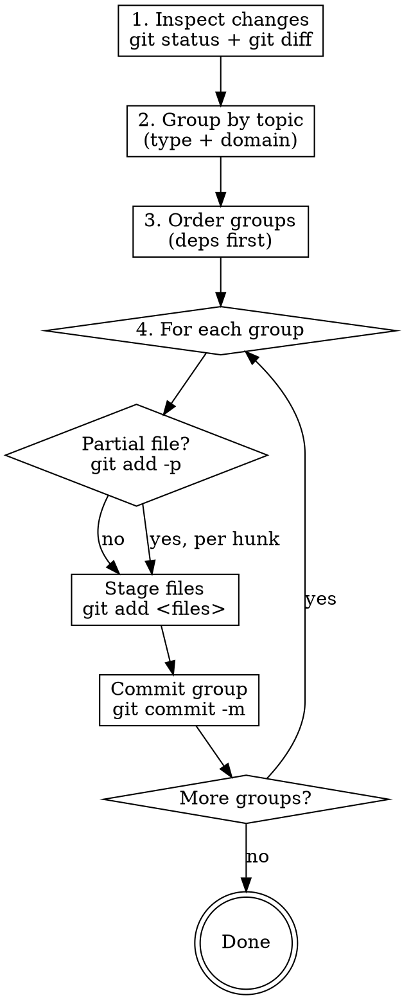

# Topic-Based Commits

## Overview

Analyze all unstaged changes, group them by logical topic, then stage and commit each group separately. One topic = one commit.

## When to Use

- User asks to commit ("commit 해줘", "커밋해줘", etc.)
- Multiple files changed across different features, fixes, or concerns
- Changes mix feat/fix/chore/refactor types

**Do NOT use when:** All changes belong to one logical unit — commit as a single commit.

## Core Process



## Step 1: Inspect All Changes

```bash
git status                    # overview of changed files
git diff                      # full diff of unstaged changes
git diff --stat               # compact summary by file
```

Read the diff — don't rely on filenames alone. A single file (e.g., `app.module.ts`) often contains changes from multiple topics.

## Step 2: Group by Topic

A **topic** = one Conventional Commits type + one domain scope.

| Type | When |
|------|------|
| `feat` | New behavior added |
| `fix` | Bug corrected |
| `chore` | Config, deps, tooling |
| `refactor` | Structure changed, no behavior change |
| `test` | Tests only |
| `docs` | Documentation only |

**Grouping rules:**
- Same type + same domain → one commit
- Different types → separate commits even if in same file
- Config changes that enable a feature → include in the `feat` commit, not a separate `chore`

## Step 3: Order Groups

Commit in dependency order:
1. Infrastructure / config changes first (e.g., env vars, module wiring)
2. Core domain logic
3. Controller / transport layer
4. Tests last (or with the code they test)

## Step 4: Stage and Commit Each Group

**Whole files:**
```bash
git add services/api/src/auth/auth.service.ts services/api/src/auth/auth.repository.ts
git commit -m "feat: JWT 인증 서비스 구현"
```

**Partial file (mixed topics in one file):**
```bash
git add -p services/api/src/app.module.ts
# interactively select hunks: y=stage, n=skip, s=split hunk, q=quit
git commit -m "feat: AuthModule 등록"
```

**Commit message format (this project):**
```
<type>(<scope>): <한글 명사형 또는 동사 원형>
```
Examples: `feat: 파일 업로드 API 추가`, `fix: 토큰 갱신 오류 수정`, `chore: 의존성 업데이트`

## File Type Edge Cases

| File state | Staging method |
|------------|---------------|
| Modified (tracked) | `git add <file>` or `git add -p` |
| New / untracked | `git add <file>` only — `git add -p` not available |
| Deleted | `git add <file>` (stages the deletion) |
| Binary (image, etc.) | `git add <file>` only — no hunk splitting |

## Common Mistakes

| Mistake | Fix |
|---------|-----|
| `git add .` for first group | Stage only files/hunks for that group |
| Skipping `git diff` and relying on filenames | Always read the diff — filenames lie |
| Ignoring mixed-topic files | Use `git add -p` to split by hunk |
| Trying `git add -p` on new/untracked files | Use `git add <file>` instead |
| Committing tests before the code they test | Reorder: code first, tests after (or together) |
| Unstaged remainder forgotten | Run `git status` after each commit to verify |

## Verification After Each Commit

```bash
git status          # confirm correct files remain unstaged
git log --oneline   # confirm commit landed correctly
```

After all groups committed:
```bash
git status          # should show clean working tree (or expected remainder)
```
